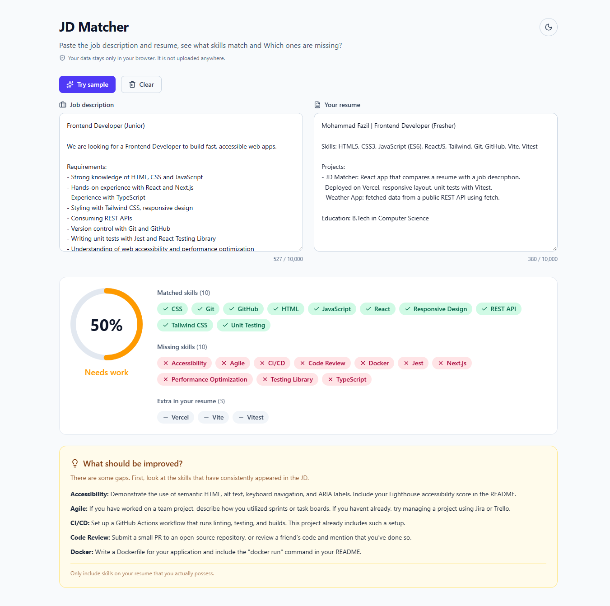
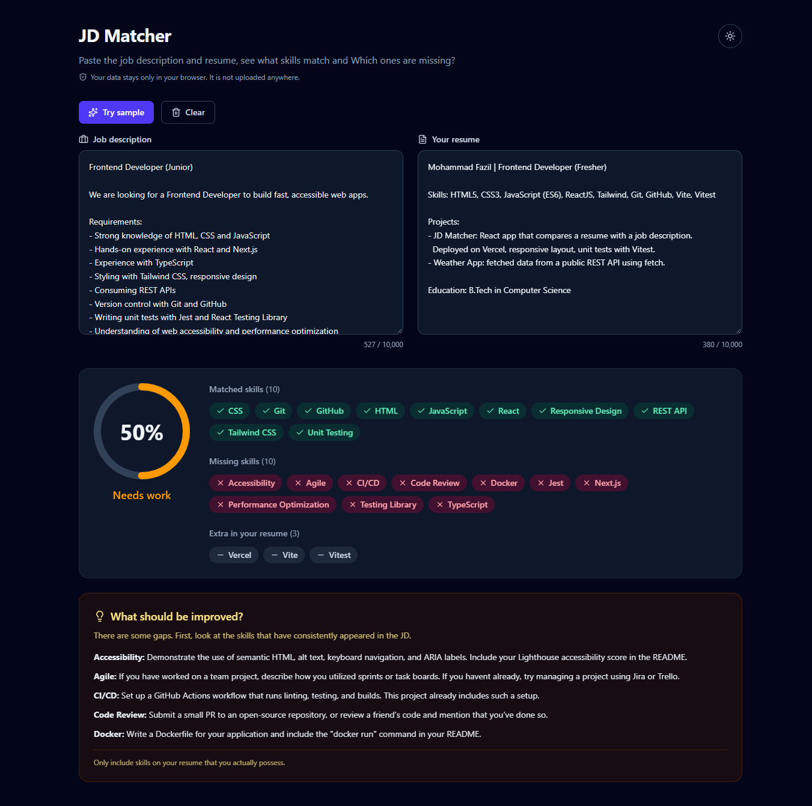

# JD Matcher


Paste a job description and your resume to see how well your skills match, which skills are missing, and what to improve. Everything runs in your browser. Nothing is uploaded.

**[Live demo](https://jd-matcher-roan.vercel.app)**

<!--  -->

## Why I built this

I'm a fresher applying to frontend roles, and tailoring my resume to every job description by hand was slow. I built this tool to see, in seconds, which skills a JD asks for that my resume doesn't show. I use it for my own applications.

## Features

- Weighted skill match score (0-100) with an animated score ring
- Matched, missing and extra skills, sorted by how often the JD mentions them
- Improvement tips for the most important missing skills
- Live results with debounced input (no Analyze button needed)
- "Try sample" button to see a demo without pasting anything
- Inputs saved in `localStorage`, so a refresh doesn't lose your text
- Dark and light mode (follows system preference, remembers your choice, no flash on load)
- Responsive layout, labelled form fields, `aria-live` results and visible focus states
- Unit tests for the matching logic, linted and tested on every push via GitHub Actions

## Screenshots

| Light                                    | Dark                                   |
| ---------------------------------------- | -------------------------------------- |
|  |  |

## How the matching works

1. **Normalize** the text: lowercase, unify unicode dashes and quotes, collapse whitespace. Punctuation is kept on purpose so `c++`, `c#` and `node.js` survive.
2. **Extract skills** using a dictionary of ~120 skills and their aliases (`reactjs`, `react.js` → `React`). All aliases are compiled into one regex, sorted longest-first so `react native` matches before `react`.
3. **Word boundaries** use lookbehind and lookahead, so `java` is not found inside `javascript`, and `git` is not found inside `github`.
4. **Score** = weighted overlap. A skill's weight is how often the JD mentions it, capped at 3 so one repeated word can't dominate.
   `score = (weight of matched skills / weight of all JD skills) × 100`
5. **Suggestions** come from the top missing skills, with a tip for each.

## Tech stack

React, Vite, Tailwind CSS v4, Vitest, React Testing Library, ESLint, Prettier, Husky + lint-staged, GitHub Actions, Vercel.

## Run locally

```bash
git clone https://github.com/<username>/jd-matcher.git
cd jd-matcher
npm install
npm run dev
```

| Command            | What it does         |
| ------------------ | -------------------- |
| `npm run dev`      | Start the dev server |
| `npm run build`    | Production build     |
| `npm run lint`     | Run ESLint           |
| `npm run test:run` | Run unit tests once  |
| `npm run format`   | Format with Prettier |

## Challenges and decisions

- **`java` matching inside `javascript`.** A plain substring search gave wrong matches. Fixed with boundary assertions in the regex, and covered with unit tests.
- **Special characters.** `c++` breaks a naive regex. I escape every alias before building the pattern.
- **Theme flash on refresh.** React loads after the first paint, so the page flashed white in dark mode. A small inline script in `index.html` sets the theme before render.
- **One word skewing the score.** A skill repeated 10 times in a JD made it dominate, so each skill's weight is capped.

## Limitations

- It is keyword matching, not understanding. "No experience with Docker" still counts as a Docker mention.
- Only skills in the dictionary are detected.
- No PDF upload yet. Paste your resume as text.

## Roadmap

- [ ] History of past checks
- [ ] PDF resume upload
- [ ] Smarter matching with NLP or embeddings
- [ ] TypeScript migration

## A note on honesty

Add only the skills you really have. The tool helps you present your experience clearly, not invent it.
